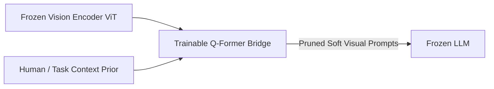

# Applied AI & Multimodal Systems Workshops

Code-first technical sessions covering tokenization, audience-aware NLP, multimodal vision-language bridges, and sparse parameter-efficient fine-tuning.

## 01 · Expansive Tokenization & Context-of-Interest Routing

- **Repository:** [evecount/expansive_tokenization](https://github.com/evecount/expansive_tokenization)
- **What participants build:** Custom control-token vocabularies and lightweight pre-tokenizer routers that steer downstream LLMs without retraining the full model.
- **Best for:** Teams building domain-specific copilots, multi-tool routers, or low-latency command dispatchers.

## 02 · Text Classification by Audience

- **Repository:** [evecount/text_classification_by_audience](https://github.com/evecount/text_classification_by_audience)
- **What participants build:** Multi-lens classifiers that evaluate the same text across distinct stakeholder perspectives (consumer, institutional, operational) instead of assuming a single flat label.
- **Best for:** Comms, trust & safety, product analytics, and applied NLP teams.

## 03 · Autoregressive + Diffusion Cinematography & Continuity

- **Repository:** [evecount/diffusion_model_oops_britney](https://github.com/evecount/diffusion_model_oops_britney)
- **What participants build:** Causal world-state tracking across visual frames so generative pipelines preserve objects, lighting, and identity across cuts.
- **Best for:** Creative AI teams, video/storyboard builders, and multimodal engineers.

## 04 · Coordinate-Index Sparse Adapter Compression (CISAC)

- **Repository:** [evecount/Coordinate_Index-Based-Sparse-Adapter-Compression](https://github.com/evecount/Coordinate_Index-Based-Sparse-Adapter-Compression)
- **What participants build:** Sparse coordinate-index adapters that slash adapter memory footprint and accelerate attention without sacrificing task fidelity.
- **Best for:** ML engineers running fine-tuned models on laptops, edge devices, or tight GPU budgets.

## 05 · Multimodal Bridges & Semantic Pruning (CLIP → BLIP-2 → Agents)

- **What participants learn:** How BLIP-2 bridges frozen vision encoders and frozen LLMs via Q-Former soft prompts—and how real-time context priors prune irrelevant semantic branches for faster, cheaper inference.
- **Best for:** Engineers integrating VLMs (Qwen2.5-VL, Llama-3.2-Vision, LLaVA, Gemini) into live workflows.
